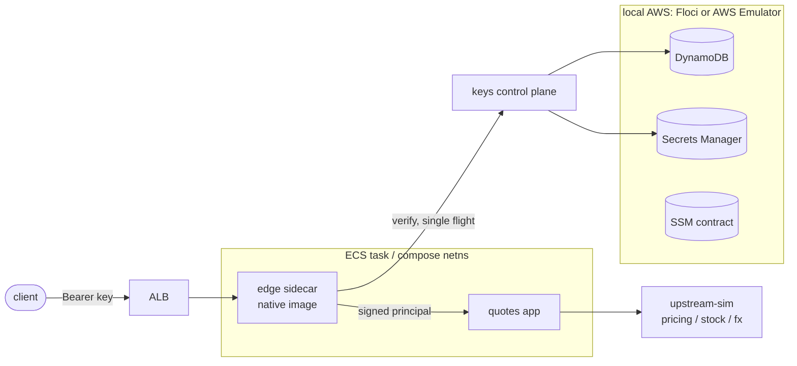
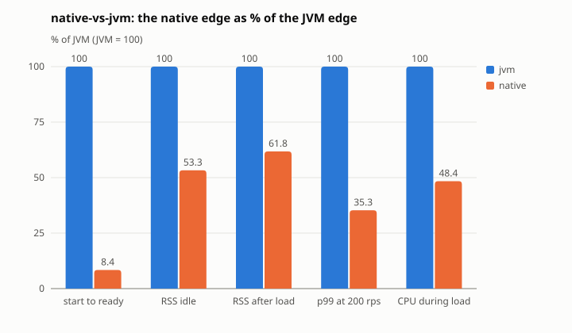
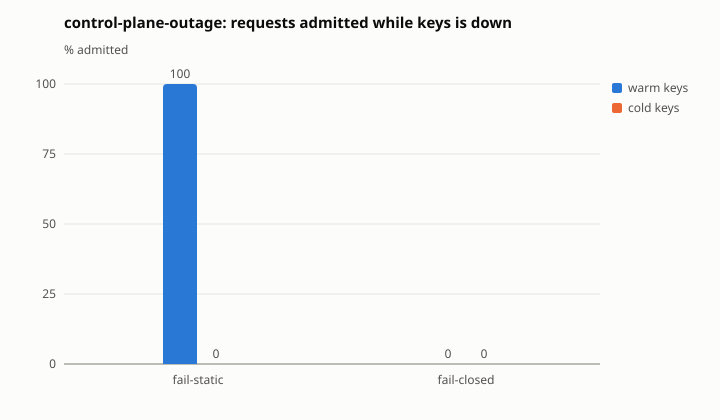

# keyedge

> **A lab, not a product.** One question answered with code, tests and measurements: *how do you issue, store
> and rotate API keys safely, and how does a small sidecar next to every service authenticate, rate-limit and
> protect it without becoming the outage itself?* Everything runs locally, on two AWS emulators; no phase
> touches a real AWS account.

A control plane issues hashed, rotatable API keys (Java 25, Micronaut 5, DynamoDB). A **GraalVM-native
sidecar** checks every request next to the app it protects: verdict cache with single flight and refresh-ahead,
a lock-free limiter proven with jcstress, a circuit breaker with a fail-static policy, adaptive concurrency.
The demo app behind it fans out to three flaky upstreams three ways (structured concurrency, futures on virtual
threads, a Reactor twin). The AWS footprint is a CDK app written twice, in Java and in Python, proven
byte-identical, and it runs as a real two-container ECS task on an emulator.



## Run it

Requirements: Docker, a JDK ≥ 17 to start Gradle (it provisions Java 25 through toolchains), Node 22 (CDK
CLI), uv. Nothing is installed system-wide.

```bash
cp .env.example .env                  # KEYEDGE_AWS_TARGET=floci (default) or aws-emulator
make cdk-synth && make images         # templates and JVM images
make up && make demo                  # emulator, CDK stacks, services; token -> key -> signed quote -> revoke
make up TARGET=aws-emulator           # the same on the second emulator (latest package, telemetry off)
make help                             # every target
```

## What this demonstrates

| Claim | Evidence |
|---|---|
| A naive token bucket over-admits under a race; the CAS limiters never do | jcstress: 10.6 % of ~200 M samples vs 0 forbidden outcomes ([naive-bucket-race](docs/lab-notebook.md#naive-bucket-race-phase-003), [results](results/labs/naive-bucket-race.json)) |
| A GCRA decision is cheap and on par with Bucket4j | JMH: 33 ns/op uncontended, 0.81× Bucket4j ([results](results/labs/limiter-cost.json)) |
| 500 concurrent misses for one key cost one verify call | single flight: 1 call reached keys ([results](results/labs/single-flight.json)) |
| Refresh-ahead removes the expiry stall | p99 0.28 ms vs 288 ms expire-only ([results](results/labs/refresh-ahead.json)) |
| The control plane can go down without taking traffic with it | fail-static: warm keys 100 % admitted, cold keys 0 %, revoked 0 ([results](results/labs/control-plane-outage.json)) |
| A breaker turns a slow dependency into a fast answer | p99 after the first second 0.9 ms vs 311 ms without ([results](results/labs/breaker-vs-none.json)) |
| Adaptive concurrency keeps goodput through a brown-out | 26× the goodput of a fixed limit ([results](results/labs/adaptive-vs-fixed.json)) |
| `ThreadLocal` context leaks across pooled threads; `ScopedValue` cannot | 6 of 20 anonymous requests saw another tenant, 0 with ScopedValue ([results](results/labs/scoped-vs-threadlocal.json)) |
| Native sidecar vs JVM | start 322 ms vs 3 855 ms, RSS 88 vs 166 MiB, p99 51 vs 146 ms at 200 req/s ([results](results/labs/native-vs-jvm.json), [chart](docs/media/native-vs-jvm.svg)) |
| Java and Python CDK apps describe the same infrastructure | 18 of 18 templates byte-identical ([parity](docs/infra.md), [results](results/parity/cdk-templates.json)) |
| The same templates run as a real task on an emulator | smoke through the task and the emulated ALB; the gaps are rows in [parity.md](docs/parity.md) |

Refuted results are kept: three bench hypotheses failed, each for a reason found in the data (quotes'
bulkheads, the edge's own adaptive limiter, CPU headroom), and the notebook says which.

## Measured results

<!-- bench:begin -->
22 experiments with a hypothesis written before the run: 15 confirmed, 6 refuted, 1 inconclusive ([lab notebook](docs/lab-notebook.md)).

| Bench | Verdict | Finding | Results |
|---|---|---|---|
| vt-vs-reactor | **refuted** | saturation within ±15 % of the Reactor twin: no; p99 within ±20 % at rates ≤ 100 rps: yes | [bench-result.json](results/bench/20261123-165813-vt-vs-reactor/bench-result.json) |
| native-overhead | **refuted** | at 100 rps the edge adds 8.13 ms p50 (limit 2) and 199.38 ms p99 (limit 5) | [bench-result.json](results/bench/20261123-172451-native-overhead/bench-result.json) |
| fargate-size | **refuted** | at 200 rps: native 0.25 vCPU misses, JVM 0.25 vCPU misses, JVM 0.5 vCPU misses the SLO | [bench-result.json](results/bench/20261123-173240-fargate-size/bench-result.json) |


<!-- bench:end -->



## Two emulators, one contract

The same contract suite runs on Floci and on AWS Emulator in CI; where they differ from each other or from AWS's
documented behaviour, [docs/parity.md](docs/parity.md) has a row (TTL timing, `DependsOn HEALTHY`, shared
`localhost` in a task, an ECS that runs no containers, ALB deregistration timing). Claims that need a real account
(IAM and KMS policies, Fargate timings, real ALB draining) are labelled untested.

## Design notes

- **Layering everywhere:** domain (pure, sealed types) → app (use cases over ports) → adapters → wiring; ArchUnit
  enforces it per module. [ADR index](docs/adr/).
- **Key format and storage:** prefix + checksum (rejects typos without a lookup), HMAC-SHA256 with a versioned
  pepper, rotation with an overlap window ([ADR 0003](docs/adr/0003-hashing-api-keys.md)).
- **Bounded revocation:** a revoked key keeps working at a sidecar until its cached verdict expires (60 s), and
  while the control plane is down up to TTL + stale window (5 min) under fail-static
  ([ADR 0009](docs/adr/0009-edge-admission.md), [ADR 0010](docs/adr/0010-fail-static-control-plane-policy.md)).
- **Sidecar → app:** a signed principal header, never "it came from localhost"; on ECS the app is found through the
  task metadata ([ADR 0018](docs/adr/0018-sidecar-finds-the-app-through-task-metadata.md)).
- More: [architecture](docs/architecture.md), [threat model](docs/threat-model.md), [runbook](docs/runbook.md),
  [virtual threads vs Reactor](docs/virtual-threads-vs-reactor.md), [infrastructure](docs/infra.md),
  [lab notebook](docs/lab-notebook.md), [interview notes](docs/interview-notes.md), [blog drafts](docs/blog/).

## What I would do differently with a real account

- Test IAM and KMS key policies for real (the emulators accept any request signed with their own keys).
- Measure ALB connection draining and task start order on Fargate; the emulators cannot show either.
- Size the edge from Fargate CPU numbers, not cgroup limits, and size the quotes bulkheads from measured latency
  under load.
- Use Spot capacity for the stateless tasks and test interruption handling.

## Build and quality

```bash
make lint test        # Spotless, Checkstyle, Error Prone + NullAway, ArchUnit, forbidden terms, fast tests
make test-aws TARGET=floci ; make test-aws TARGET=aws-emulator   # the AWS contract suite
make cdk-test-all && make cdk-parity                             # both CDK apps, identical templates
make report && make docs-check                                   # generated docs match the results
make release-check                                               # the pre-tag checklist
```

CI ([.github/workflows](.github/workflows)) runs on pull requests, version tags and manual dispatch, never on a push
to a branch; actions are pinned by SHA; nothing is granted by default.

## License

MIT, see [LICENSE](LICENSE).
