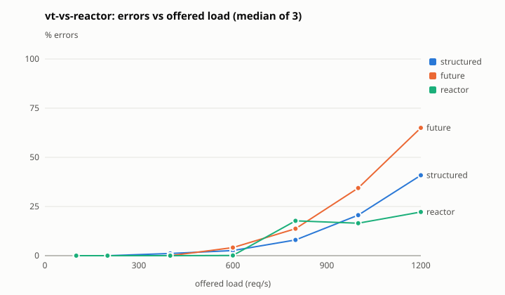
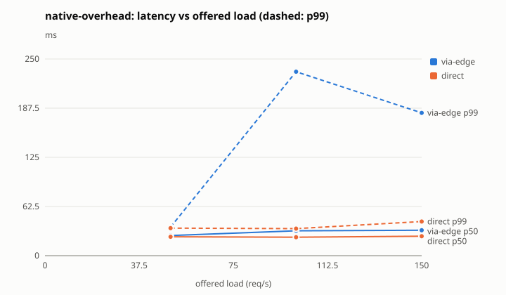
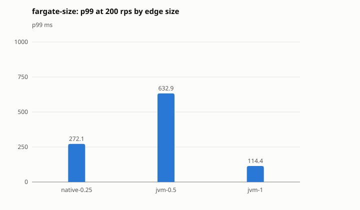

# Lab notebook

Each experiment: a hypothesis written before the run, the measurement, a verdict (`confirmed`,
`refuted`, `inconclusive`), and the result file it comes from. Refuted results stay.

Each section was written when its phase ran, and the numbers in its prose are from that run (the results
file's git history keeps it). `make lab-all` re-ran the in-process experiments on 2026-11-24: the index below
shows the verdicts of the latest results files, and `make docs-check` fails if a section's stated verdict
disagrees with them (it caught cancel-on-failure).

## Index

<!-- notebook:index:begin -->
| Experiment | Phase | Verdict | Results |
|---|---|---|---|
| [naive-bucket-race](#naive-bucket-race-phase-003) | 003 | **confirmed** | [naive-bucket-race.json](../results/labs/naive-bucket-race.json) |
| [limiter-cost](#limiter-cost-phase-003) | 003 | **confirmed** | [limiter-cost.json](../results/labs/limiter-cost.json) |
| [emulator-parity](#emulator-parity-phase-004) | 004 | see section | see section |
| [idempotency-race](#idempotency-race-phase-005) | 005 | **confirmed** | [idempotency-race-aws-emulator.json](../results/labs/idempotency-race-aws-emulator.json), [idempotency-race-floci.json](../results/labs/idempotency-race-floci.json) |
| [pepper-rotation](#pepper-rotation-phase-005) | 005 | **confirmed** | [pepper-rotation-aws-emulator.json](../results/labs/pepper-rotation-aws-emulator.json), [pepper-rotation-floci.json](../results/labs/pepper-rotation-floci.json) |
| [single-flight](#single-flight-phase-007) | 007 | **confirmed** | [single-flight.json](../results/labs/single-flight.json) |
| [refresh-ahead](#refresh-ahead-phase-007) | 007 | **confirmed** | [refresh-ahead.json](../results/labs/refresh-ahead.json) |
| [vt-handoff](#vt-handoff-phase-007) | 007 | **confirmed** | [vt-handoff.json](../results/labs/vt-handoff.json) |
| [control-plane-outage](#control-plane-outage-phase-008) | 008 | **confirmed** | [control-plane-outage.json](../results/labs/control-plane-outage.json) |
| [breaker-vs-none](#breaker-vs-none-phase-008) | 008 | **confirmed** | [breaker-vs-none.json](../results/labs/breaker-vs-none.json) |
| [adaptive-vs-fixed](#adaptive-vs-fixed-phase-008) | 008 | **confirmed** | [adaptive-vs-fixed.json](../results/labs/adaptive-vs-fixed.json) |
| [fanout-models](#fanout-models-phase-009) | 009 | **confirmed** | [fanout-models.json](../results/labs/fanout-models.json) |
| [cancel-on-failure](#cancel-on-failure-phase-009) | 009 | **refuted** | [cancel-on-failure.json](../results/labs/cancel-on-failure.json) |
| [retry-only-idempotent](#retry-only-idempotent-phase-009) | 009 | **confirmed** | [retry-only-idempotent.json](../results/labs/retry-only-idempotent.json) |
| [token-stampede](#token-stampede-phase-009) | 009 | **confirmed** | [token-stampede.json](../results/labs/token-stampede.json) |
| [native-vs-jvm](#native-vs-jvm-phase-010) | 010 | **refuted** | [native-vs-jvm.json](../results/labs/native-vs-jvm.json) |
| [pinning](#pinning-phase-011) | 011 | **confirmed** | [pinning.json](../results/labs/pinning.json) |
| [scoped-vs-threadlocal](#scoped-vs-threadlocal-phase-011) | 011 | **confirmed** | [scoped-vs-threadlocal.json](../results/labs/scoped-vs-threadlocal.json) |
| [task-start-order](#task-start-order-phase-014) | 014 | **refuted** | [task-start-order.json](../results/ecs/task-start-order.json) |
| [drain-on-deploy](#drain-on-deploy-phase-014) | 014 | **inconclusive** | [drain-on-deploy.json](../results/ecs/drain-on-deploy.json) |
| [vt-vs-reactor](#vt-vs-reactor-phase-015) | 015 | **refuted** | [bench-result.json](../results/bench/20261123-165813-vt-vs-reactor/bench-result.json) |
| [native-overhead](#native-overhead-phase-015) | 015 | **refuted** | [bench-result.json](../results/bench/20261123-172451-native-overhead/bench-result.json) |
| [fargate-size](#fargate-size-phase-015) | 015 | **refuted** | [bench-result.json](../results/bench/20261123-173240-fargate-size/bench-result.json) |

23 experiments: 15 confirmed, 6 refuted, 1 inconclusive, the rest described in their sections (generated by `make report` from the results files).
<!-- notebook:index:end -->

## naive-bucket-race (Phase 003)

**Hypothesis.** A token bucket that reads its two fields, computes, then writes them back (each field
`volatile`, the sequence not atomic) over-admits when two threads race for the last token. The
single-`AtomicLong` CAS limiters (GCRA, packed token bucket) never do, and a permit can be released only once.

**Method.** jcstress, `quick` mode, time frozen so no refill can explain a second admit; two (GCRA: three)
actors race for 1 (GCRA: 2) permits; `true, true` is declared FORBIDDEN for the correct limiters and
INTERESTING for the naive one. `make lab E=naive-bucket-race`.

**Result** ([results/labs/naive-bucket-race.json](../results/labs/naive-bucket-race.json)): verdict
**confirmed**. The naive bucket over-admitted in **12.1 %** of ~197 M samples (23.8 M times both threads got
the single token). The correct limiters and the permit: **0** forbidden outcomes in 268 jcstress runs.

**Interview line.** "Unit tests with threads showed the naive bucket working. jcstress ran ~200 million
interleavings and showed both threads taking the last token one time in eight; the CAS version never did."

## limiter-cost (Phase 003)

**Hypothesis.** A GCRA decision costs well under ~100 ns uncontended; with 16 threads on one key it stays
within ~10× of that; it is within 2× of Bucket4j on the same plan (1 M/s, burst 1 000).

**Method.** JMH 1.37, average time, 2 forks × (3 warm-up + 5 measured) × 1 s, `-prof gc`, Java 25,
on a shared WSL2 host (other stacks running; compare only within this run). `make lab E=limiter-cost`.

**Result** ([results/labs/limiter-cost.json](../results/labs/limiter-cost.json), raw
[results/jmh/2026-11-23-82e68d9/jmh.json](../results/jmh/2026-11-23-82e68d9/jmh.json)): verdict **confirmed**.

| benchmark | ns/op |
|---|---|
| GCRA, 1 thread | 23.6 |
| GCRA, 16 threads, one key | 140.0 (5.9×) |
| Bucket4j, 1 thread / 16 threads | 38.3 / 155.5 |
| packed token bucket, 1 thread / 16 threads | 36.1 / 222.7 |
| 100 000 keys, Caffeine-bounded map | 491.3 |
| 100 000 keys, plain `ConcurrentHashMap` (baseline) | 152.3 |
| fixed / AIMD acquire + release | 15.9 / 16.2 |

**What surprised us.** The per-key map, not the limiter, dominates when keys are many: ~150 ns is the cost of
touching 100 000 objects at random (cache misses), Caffeine's bounded-map bookkeeping adds ~340 ns. A first
guess (`compute()` locking) was wrong: a read-first fast path changed nothing measurable; the plain-map
baseline found the real split.

**Interview line.** "One limiter decision is ~25 ns; under heavy contention on one key ~140 ns. With 100 000
keys the map costs more than the limiter — and I only learnt that by adding a baseline benchmark."

## emulator-parity (Phase 004)

**Hypothesis.** Both emulators pass the AWS contract suite (the DynamoDB, Secrets Manager, SSM, KMS and STS
behaviours keyedge relies on) except a short list of documented differences: TTL timing, KMS ciphertext format,
error shapes.

**Method.** One abstract JUnit suite, two subclasses (Testcontainers: Floci 2.5.0 pinned by digest; AWS Emulator
built from its latest package, port 15298, telemetry off). Each case creates its own resources. `make emu-parity`.

**Result** ([docs/parity.md](parity.md), raw `results/parity/<run>.json`): verdict **confirmed, with fewer
differences than predicted**. All 9 shared contract cases pass on both, including transaction cancellation
reasons per item and KMS encryption-context enforcement (predicted as a likely difference, it was not). The
measured difference is TTL timing (Floci ~1 min sweep, AWS Emulator seconds). The real gaps are runtime
behaviours (ECS, ALB, a CloudFormation detail), tracked as P-02…P-10.

**Interview line.** "I didn't trust the feature lists: the same contract tests run on two emulators every PR,
and the parity page is generated from those runs — including the rows where an emulator is wrong."

## idempotency-race (Phase 005)

**Hypothesis.** Two identical `POST /v1/keys` with the same `Idempotency-Key`, sent at the same moment, create
exactly one key; the other request gets a replay or an in-flight conflict, never a second key.

**Method.** 50 pairs of concurrent calls to the `IssueKey` use case on virtual threads, with the real DynamoDB
adapter, on each emulator. Independent count: the tenant's keys read back through the list index.

**Result** (`results/labs/idempotency-race-{floci,aws-emulator}.json`): verdict **confirmed** on both — 50 keys
stored for 50 pairs; outcomes 50 `Issued` + 50 `InFlight`. The guarantee comes from one `TransactWriteItems`
(key put + idempotency record `IN_FLIGHT → DONE`), whose cancellation reasons say *which* condition failed.

**Interview line.** "The key and 'request done' are written in one transaction, so a key can't exist without its
idempotency record saying so; the cancellation reason index tells an id collision from a lost claim."

## pepper-rotation (Phase 005)

**Hypothesis.** Keys hashed with an old pepper keep verifying after a new pepper becomes current; new keys use
the new pepper; removing the old pepper invalidates exactly the keys that used it.

**Result** (`results/labs/pepper-rotation-{floci,aws-emulator}.json`): **confirmed** on both — old key pepper 1,
new key pepper 2, both `Valid` after rotation, the old key `Unknown` once pepper 1 is retired.

## single-flight (Phase 007)

**Hypothesis.** 500 concurrent requests with one cold key cause exactly **1** verify call to keys.
**Method.** The sidecar's real verdict cache and HTTP verify client against a fake keys server that answers after
100 ms and counts requests (the independent counter); 500 virtual threads released by one latch.
**Result** ([results/labs/single-flight.json](../results/labs/single-flight.json)): **confirmed**, 1 call.

## refresh-ahead (Phase 007)

**Hypothesis.** With refresh at 70 % of the TTL, p99 does not spike when a hot key's entry expires; with
expire-only, every request arriving during the reload waits for it.
**Method.** 200 req/s for 8 s on one key, TTL hint 2 s, verify latency 300 ms; refresh ratio 0.7 vs 1.0.
**Result** ([results/labs/refresh-ahead.json](../results/labs/refresh-ahead.json)): **confirmed on the second
implementation** — p99 0.32 ms with refresh-ahead vs 285 ms expire-only. The **first** run was **refuted**
(p99 233 vs 284 ms): requests that had read the old entry kept re-triggering Caffeine's `refresh()` after each
reload, refreshes cascaded and one turned into a blocking load. Fixed with an explicit refresh: one in-flight
refresh per key (a flag), the reloaded value swapped in as a completed future.
**Interview line.** "The experiment refuted my first refresh-ahead: in-flight readers re-armed the refresh. The
measured fix — one refresh per key, swap in a completed future — took p99 from 285 ms to 0.3 ms."

## vt-handoff (Phase 007)

**Hypothesis.** Moving the sidecar's decision from the calling thread to a virtual thread and back costs
< 0.1 ms median.
**Result** ([results/labs/vt-handoff.json](../results/labs/vt-handoff.json)): **confirmed**, median +0.088 ms,
p99 +0.157 ms over 20 000 calls (close to the threshold on this shared host; one earlier run measured above it).

## control-plane-outage (Phase 008)

**Hypothesis.** With keys down, fail-static keeps admitting warm valid keys (≥ 99 % after their TTL) while
fail-closed rejects them (≤ 1 %); revoked keys are never admitted under either policy.
**Method.** In-process: the real verdict cache, breaker and HTTP verify client against a fake keys server
(its counters are the independent measurement). 300 req/s for 10 s — 80 % over 40 warm keys, 10 % cold keys,
10 % over 5 revoked keys; TTL 2 s, stale window 30 s; keys answers 503 from t = 2 s. Counted after the TTL.
**Result** ([results/labs/control-plane-outage.json](../results/labs/control-plane-outage.json)): **confirmed** —
warm keys 100 % (fail-static, ~1 600 stale answers) vs 0 % (fail-closed); cold keys 0 % under both; revoked keys
admitted 0 times; only 25–26 verify calls reached keys during the outage (the breaker opened). The first run reported
300 revoked admissions: a bug in the **fake** (it revoked one of the five ids), caught because the experiment
counted revoked keys separately. Stack check: `make resilience-check` on both emulators (ADR 0010).

## breaker-vs-none (Phase 008)

**Hypothesis.** With keys hanging, every cold request waits for the 300 ms timeout without a breaker; with one,
p99 < 50 ms once it is open and keys stops receiving calls.
**Method.** 100 req/s for 5 s, every request a never-seen key, keys answers after 5 s.
**Result** ([results/labs/breaker-vs-none.json](../results/labs/breaker-vs-none.json)): **confirmed** — p99 after
the first second 301 ms without vs 0.6 ms with the breaker; 500 vs 50 calls reached keys (max 500 vs 50 in flight
at keys).
**Interview line.** "The breaker is less about our latency than about the control plane: it went from 500 hanging
requests to 50 and then silence, which is what lets it recover."

## adaptive-vs-fixed (Phase 008)

**Hypothesis.** In a brown-out (capacity 800 → 267 req/s) under 600 req/s offered, an adaptive concurrency limit
sheds the excess early and keeps goodput (2xx within 500 ms) ≥ 1.2× a fixed limit of 200.
**Method.** An app with 16 workers, 20 ms service time, 60 ms from t = 3 s; open-model load 600 req/s for 11 s
through each limiter from `libs/ratelimit`; goodput over the 8 s brown-out.
**Result** ([results/labs/adaptive-vs-fixed.json](../results/labs/adaptive-vs-fixed.json)): **confirmed** —
goodput 27/s fixed (p99 774 ms: 200 in flight queue behind 16 workers, Little's law) vs 239/s gradient (p99
187 ms) and 268/s AIMD (p99 468 ms); ratio gradient/fixed 8.9. AIMD reached more goodput but ran close to the
SLO; gradient kept latency low. The edge defaults to gradient.
**Re-run (Phase 010)** with a fourth row, gradient with RTT tolerance 2.0 (the fix from `native-vs-jvm`); the
JSON holds this run: fixed 0/s (p99 807 ms), gradient 225/s (p99 147 ms), AIMD 266/s (p99 464 ms), tolerant
gradient 250/s (p99 340 ms) — still within the SLO, so the tolerance costs no brown-out protection here.
**Interview line.** "A fixed limit of 200 looked generous until capacity fell: Little's law turned it into a
750 ms queue and almost nothing met the SLO. The adaptive limit shrank to what the app could serve."

## fanout-models (Phase 009)

**Hypothesis.** At 10 req/s the structured, futures and Reactor versions of the quote have the same p50 (within
10 %, about the slowest upstream); at 300 req/s all three keep up.
**Method.** The real quotes adapters (JDK `HttpClient`, guards, token provider) against fake upstreams (pricing
20 ms, stock 10 ms, fx 5 ms); open-model load 5 s per row. Functional size only: load curves are Phase 015.
**Result** ([results/labs/fanout-models.json](../results/labs/fanout-models.json)): **confirmed** — p50 at
10 req/s within 5.7 % (23.0–24.3 ms); at 300 req/s no errors and no model ahead (p50 25–28 ms; tails noisy on a
shared host). Discussion in [virtual-threads-vs-reactor.md](virtual-threads-vs-reactor.md#5-evidence).

## cancel-on-failure (Phase 009)

**Hypothesis.** When pricing fails at 50 ms and stock takes 2 s, the structured fan-out returns in < 150 ms and
the stock calls are really cancelled.
**Method.** stock is a raw-socket server that counts clients hanging up before it answers (the independent
measurement); 5 quotes per adapter; plus the deliberately naive `CompletableFuture` version (lab/pitfalls).
**Result** ([results/labs/cancel-on-failure.json](../results/labs/cancel-on-failure.json)): **refuted** on the
2026-11-24 re-run (`make lab-all`), **confirmed** in Phase 009. The cancellation part held both times: structured
and futures-with-`submit` close all 5 stock connections, and the naive version returns just as fast (54 ms p50)
**but all 5 stock calls run to completion**: "cancelled" on the client, still working on the server. What failed is
the latency bound as written ("returns in < 150 ms", checked on the maximum of 5): the structured adapter's
slowest call took 311 ms (p50 58 ms). It runs first, with no warm-up, so the maximum includes the first, cold call
through a preview API. The rule stays as written for this run; the next run gets a discarded warm-up call and a
rule on the p50, pre-registered (B-39). Phase 009's run: p50 64–72 ms, maximum 101 ms.
**Interview line.** "Both versions looked fast. Only the server's own count showed that the naive one kept every
slow call running."

## retry-only-idempotent (Phase 009)

**Hypothesis.** With stock answering 503, 100 reservations (POST) reach it exactly 100 times; 100 GETs are
retried at most once each and within the retry budget.
**Result** ([results/labs/retry-only-idempotent.json](../results/labs/retry-only-idempotent.json)):
**confirmed** — POST attempts 100; GET attempts 129: the budget (10 + 10 % of 200 calls = 30) granted 29 retries
and then said no, before the 2-attempt limit would have allowed 100.

## token-stampede (Phase 009)

**Hypothesis.** 200 concurrent calls at token expiry cause exactly one token request.
**Method.** Token lifetime 5 s, issue latency 200 ms, refresh-ahead at 80 %; 200 callers at t = 4.9 s (due for
refresh, still valid) and again after the token has expired.
**Result** ([results/labs/token-stampede.json](../results/labs/token-stampede.json)): **confirmed** — 1 and 1
(server-side count). Before that, **jcstress found a double fetch** in the first implementation: a caller that
saw "no token" just before the first fetch completed started a second one. Fixed by reusing a just-completed
fetch whose token is still current.

## native-vs-jvm (Phase 010)

**Hypothesis.** The native edge reaches readiness in < 100 ms with < 1/3 of the JVM edge's RSS at idle and
under 200 req/s.
**Method.** `make lab E=native-vs-jvm` (`lab/native_vs_jvm.py`): the compose stack on Floci with the JVM edge, then
the native one; 5 cold starts each (`docker start` → readiness 200, polled every 10 ms; also Micronaut's own
"Startup completed" time); VmRSS of the edge process; k6 200 req/s for 30 s over 6 keys after a 20 s warm-up.
**Result** ([results/labs/native-vs-jvm.json](../results/labs/native-vs-jvm.json)): **refuted as stated** —
native: 322 ms to ready (median) of which Micronaut itself takes 21–26 ms, the rest is `docker start` and the
readiness probe path; JVM: 3.9 s (Micronaut 1.0–1.6 s). RSS 88 vs 166 MiB idle (53 %), 131 vs 213 MiB after load
(62 %): about half, not a third. Under load the native edge used 12.8 vs 26.5 CPU-seconds, p99 51 vs 146 ms, and
no errors, while the still-warming JVM edge shed 3.6 % with its adaptive limit.
**Found on the way.** The first load runs shed 7–16 % with `503 overloaded` on *both* flavours: the gradient
limiter treated a fan-out's normal latency spread (and the warm-up of a restarted quotes) as congestion and fell
to its minimum. It had no RTT tolerance (Netflix Gradient2 uses 2.0); added (`gradient-tolerance` 2.0, regression
test), and `adaptive-vs-fixed` re-run: tolerant gradient keeps the brown-out benefit (250 goodput/s, p99 340 ms).
**Interview line.** "Native won 10× on start-up and halved memory and CPU — but my '< 100 ms' was measured from
`docker start`, where the container runtime alone costs ~300 ms. Say which clock you mean."

## pinning (Phase 011)

**Hypothesis.** `synchronized` around a blocking call pins carrier threads on Java 21 (JFR
`jdk.VirtualThreadPinned`, throughput ≈ carriers / sleep) but not on Java 25 (JEP 491).
**Method.** `lab/pinning` (a plain module compiled for release 21, run on both JDKs): 1 000 virtual threads, each
`synchronized` on its own lock around a 50 ms sleep, 4 carrier threads; pinned events counted in-process with a
JFR `RecordingStream`.
**Result** ([results/labs/pinning.json](../results/labs/pinning.json)): **confirmed** — Java 21: 12.6 s
(= 1 000 × 50 ms / 4 carriers, the model exactly), 1 005 pinned events; Java 25: 0.12 s, 0 pinned events:
102× the throughput on the same bytecode.
**Interview line.** "On 21 I'd have told you to replace `synchronized` with `ReentrantLock` around I/O. On 25 that
advice is obsolete — I measured it — and JFR still finds the native-frame cases that do pin."

## scoped-vs-threadlocal (Phase 011)

**Hypothesis.** A tenant left in a `ThreadLocal` by one request is seen by a later request on the same pooled
thread; a `ScopedValue` binding cannot outlive its scope.
**Method.** 200 requests on 2 platform threads; every 10th is anonymous (sets no tenant), every 3rd forgets
`remove()`.
**Result** ([results/labs/scoped-vs-threadlocal.json](../results/labs/scoped-vs-threadlocal.json)):
**confirmed** — 7 of 20 anonymous requests saw another tenant through the `ThreadLocal`; 0 through the
`ScopedValue`. This is why the log encoder reads request fields from the `ScopedValue` at log time instead of an
MDC that must be filled and cleared.

## task-start-order (Phase 014)

**Hypothesis.** The app container does not start before the edge is HEALTHY (`dependsOn: HEALTHY` in the task
definition), visible in container start timestamps.

**Method.** The CDK quotes service as a real task on Floci 2.5 (Docker socket); container start times from Docker,
the edge's "Startup completed" log line, the ECS health status. `scripts/ecs.sh start-order`.

**Result** ([results/ecs/task-start-order.json](../results/ecs/task-start-order.json)): verdict **refuted** on
Floci. The task definition's health check is never run (ECS health UNKNOWN, no Docker health check), so the
containers start in START order: in the first run the app started 2.39 s before the edge was ready. A second run
looked right by chance (native edge ready in 0.6 s); the rule now needs ECS health HEALTHY before it confirms.

**Interview line.** "Timing alone can confirm the wrong thing: a fast sidecar is ready before a START-ordered app
anyway. The verdict needs the health check to have actually run."

## drain-on-deploy (Phase 014)

**Hypothesis.** Through the load balancer, a rolling replacement with drain (readiness DOWN → grace → drain)
shows 0 failed requests under constant load; without drain it shows a burst of 5xx or connection resets.

**Method.** 50 req/s for 90 s through the emulated ALB (Floci, 127.0.0.1:15180), `update-service
--force-new-deployment` at 10 s; 3 runs with the template's drain, 3 with grace/drain/graceful shutdown off;
the edge's own load shedding counted apart; old/new task overlap checked. `scripts/ecs.sh drain`.

**Result** ([results/ecs/drain-on-deploy.json](../results/ecs/drain-on-deploy.json)): verdict **inconclusive**.
Without drain, 0 replacement failures in 3/3 runs: Floci stops routing to the old task ~0.1–0.2 s after the new
one starts, so the old task's shutdown is never observed. The one drain-on run with failures (83 time-outs) was a
single 5 s proxy stall while Floci launched the new task.

**Interview line.** "An experiment needs a control arm that can fail. Ours couldn't on the emulator, so the
verdict says so; the drain design rests on the compose test and AWS's documented behaviour."

<!-- bench:vt-vs-reactor:begin -->
## vt-vs-reactor (Phase 015)

**Hypothesis.** On the quotes fan-out (3 upstreams, lognormal, pricing median 40 ms / p99 120 ms), the virtual-thread endpoint (structured and future adapters) reaches the same saturation rate as the Reactor twin within ±15 %, with p99 within ±20 % below saturation.

**Prediction** (written 2026-11-23T16:58:16.322367705Z, before the load). On the quotes fan-out (3 upstreams, lognormal, pricing median 40 ms / p99 120 ms), the virtual-thread endpoint (structured and future adapters) reaches the same saturation rate as the Reactor twin within ±15 %, with p99 within ±20 % below saturation. Model: W=60 ms, cap 10000 in flight -> 166667 rps; 4.0 CPUs at 2.50 ms CPU/request -> 1600 rps; predicted saturation 1600 rps (CPU-bound).

**Method.** k6 constant-arrival-rate in a container; 7 offered rates × 3 variants × 3 repetitions (medians below; generator-bound steps excluded); SLO p99 ≤ 250 ms and errors ≤ 0.1 %. `make bench S=vt-vs-reactor`.

| Variant | Rate (rps) | p50 ms | p99 ms | Errors % | Shed % | CPU ms/req | Valid steps |
|---|---|---|---|---|---|---|---|
| structured | 100 | 52.91 | 135.67 | 0.00 | 0.00 | 17.06 | 3/3 |
| structured | 200 | 50.67 | 140.57 | 0.00 | 0.00 | 8.51 | 3/3 |
| structured | 400 | 55.72 | 195.80 | 1.08 | 0.00 | 5.54 | 3/3 |
| structured | 600 | 55.32 | 160.45 | 2.62 | 0.00 | 4.14 | 2/3 |
| structured | 800 | 54.47 | 163.49 | 8.01 | 0.00 | 3.36 | 3/3 |
| structured | 1000 | 51.62 | 172.63 | 20.64 | 0.00 | 2.81 | 3/3 |
| structured | 1200 | 48.25 | 193.37 | 40.93 | 0.00 | 2.28 | 3/3 |
| future | 100 | 47.45 | 130.87 | 0.00 | 0.00 | 11.18 | 3/3 |
| future | 200 | 46.31 | 127.66 | 0.00 | 0.00 | 6.64 | 3/3 |
| future | 400 | 50.10 | 137.64 | 0.00 | 0.00 | 5.44 | 3/3 |
| future | 600 | 56.51 | 176.66 | 4.12 | 0.00 | 4.22 | 3/3 |
| future | 800 | 56.94 | 187.37 | 13.75 | 0.00 | 3.46 | 3/3 |
| future | 1000 | 52.75 | 271.58 | 34.39 | 0.00 | 2.77 | 3/3 |
| future | 1200 | 43.87 | 258.43 | 65.02 | 0.00 | 2.23 | 3/3 |
| reactor | 100 | 46.13 | 125.36 | 0.00 | 0.00 | 12.31 | 3/3 |
| reactor | 200 | 45.81 | 128.24 | 0.00 | 0.00 | 6.56 | 3/3 |
| reactor | 400 | 47.57 | 128.12 | 0.00 | 0.00 | 4.73 | 3/3 |
| reactor | 600 | 49.42 | 131.67 | 0.12 | 0.00 | 3.90 | 3/3 |
| reactor | 800 | 47.27 | 136.64 | 17.71 | 0.00 | 3.32 | 2/3 |
| reactor | 1000 | 50.82 | 138.48 | 16.48 | 0.00 | 2.70 | 3/3 |
| reactor | 1200 | 44.20 | 123.81 | 22.21 | 0.00 | 2.33 | 3/3 |

Saturation (highest rate meeting the SLO): future 100 rps, reactor 400 rps, structured 100 rps.

**Result** ([results/bench/20261123-165813-vt-vs-reactor/bench-result.json](../results/bench/20261123-165813-vt-vs-reactor/bench-result.json)): verdict **refuted**. saturation within ±15 % of the Reactor twin: no; p99 within ±20 % at rates ≤ 100 rps: yes.

**Where.** 14 CPUs, 20000 MiB, load average 8.3 at the start, Docker 29.7.2, emulator floci 2.5.0, commit c7d767a.
<!-- bench:vt-vs-reactor:end -->

**Reading** (hand-written; numbers from the results file above). The pre-registered rule says **refuted**, and
the data agrees for the structured adapter: at 400 req/s it failed the error SLO in all three repetitions
(0.9–3.3 % errors) while the futures adapter and the Reactor twin had none; at 600 req/s the Reactor twin stayed
at ≤ 0.2 % and both virtual-thread adapters failed by an order of magnitude more. The futures adapter's
"saturation 100" is one noisy repetition at 200 req/s (61 errors, then three clean repetitions at 400): the knee
rule is strict on purpose, and the spread is reported rather than smoothed.
The errors are quotes' own **bulkheads** (`BulkheadFullException`: pricing 50, stock 50, fx 20 in flight), not
the CPU budget the prediction assumed (~1 600 req/s): under a loaded host (load average 8–15 on 14 CPUs, other
projects running) every call takes longer, in-flight work grows with it (Little's Law), and the caps reject first.
The likely mechanism (not isolated by this run): the Reactor twin releases a permit on the event loop as soon as
the response arrives; a virtual thread releases it only when it is scheduled again, which under CPU contention is
later, so it holds permits longer. CPU per request was within ~15 % at 400 req/s and above (Reactor
lowest). Not shown by this run: a quiet host, larger bulkheads, or Java's scheduler tuned for the fan-out.

The first attempt went through the edge: its gradient limiter settled at 22 in flight and shed from ~200 req/s for
every variant alike, which measured the edge, not the adapters
([aborted-through-edge.log](../results/bench/20261123-164431-vt-vs-reactor/aborted-through-edge.log)).

**Interview line.** "I predicted a CPU-bound tie and measured a concurrency-bound gap: the bulkheads, sized for a
quiet machine, rejected first, and the blocking adapter held its permits longest. The prediction being wrong in
writing is what made the finding visible."

<!-- bench:native-overhead:begin -->
## native-overhead (Phase 015)

**Hypothesis.** The native edge adds < 2 ms p50 and < 5 ms p99 versus calling quotes directly, at the middle offered rate.

**Prediction** (written 2026-11-23T17:24:51.971253194Z, before the load). The native edge adds < 2 ms p50 and < 5 ms p99 versus calling quotes directly, at the middle offered rate. Model: W=35 ms, cap 500 in flight -> 14286 rps; 4.0 CPUs at 2.00 ms CPU/request -> 2000 rps; predicted saturation 2000 rps (CPU-bound).

**Method.** k6 constant-arrival-rate in a container; 3 offered rates × 2 variants × 3 repetitions (medians below; generator-bound steps excluded); SLO p99 ≤ 250 ms and errors ≤ 0.1 %. `make bench S=native-overhead`.

| Variant | Rate (rps) | p50 ms | p99 ms | Errors % | Shed % | CPU ms/req | Valid steps |
|---|---|---|---|---|---|---|---|
| via-edge | 50 | 25.57 | 36.32 | 0.00 | 0.00 | 6.42 | 3/3 |
| via-edge | 100 | 31.65 | 233.77 | 2.25 | 2.25 | 10.60 | 3/3 |
| via-edge | 150 | 32.35 | 181.52 | 5.63 | 5.63 | 9.45 | 3/3 |
| direct | 50 | 24.02 | 34.97 | 0.00 | 0.00 | 4.85 | 3/3 |
| direct | 100 | 23.52 | 34.39 | 0.00 | 0.00 | 4.02 | 3/3 |
| direct | 150 | 24.71 | 43.36 | 0.00 | 0.00 | 4.70 | 3/3 |

Saturation (highest rate meeting the SLO): direct 150 rps, via-edge 50 rps.

**Result** ([results/bench/20261123-172451-native-overhead/bench-result.json](../results/bench/20261123-172451-native-overhead/bench-result.json)): verdict **refuted**. at 100 rps the edge adds 8.13 ms p50 (limit 2) and 199.38 ms p99 (limit 5).

**Where.** 14 CPUs, 20000 MiB, load average 11.5 at the start, Docker 29.7.2, emulator floci 2.5.0, commit c7d767a.
<!-- bench:native-overhead:end -->

**Reading** (hand-written). The pre-registered rule compares the middle rate (100 req/s) and says **refuted**:
+8 ms p50 and +199 ms p99 through the edge. The cause is not the hop: every failed request on the edge path was the
edge's own load shedding (`shed` = `errors` in the results file), in two of three repetitions at 100 and 150 req/s,
with the host at load average ~11. At 50 req/s, with nothing shed, the native edge added ~1.6 ms p50 and ~1.3 ms
p99, inside the hypothesis. So the sidecar's cost per request is small; its adaptive limiter is what bites: it reads
host-noise latency as overload and lowers the limit (B-35).

**Interview line.** "The extra hop cost about 1.5 ms. What cost us 200 ms at p99 was the limiter in that hop
reacting to a noisy neighbour; that is the knob to tune, not the sidecar."

<!-- bench:fargate-size:begin -->
## fargate-size (Phase 015)

**Hypothesis.** The native edge meets the SLO (p99 ≤ 150 ms total, errors ≤ 0.1 %) at 0.25 vCPU / 256 MiB; the JVM edge does not at that size and needs 0.5 vCPU / 512 MiB.

**Prediction** (written 2026-11-23T17:32:41.654833066Z, before the load). The native edge meets the SLO (p99 ≤ 150 ms total, errors ≤ 0.1 %) at 0.25 vCPU / 256 MiB; the JVM edge does not at that size and needs 0.5 vCPU / 512 MiB. Model: W=35 ms, cap 500 in flight -> 14286 rps; 0.3 CPUs at 1.00 ms CPU/request -> 250 rps; predicted saturation 250 rps (CPU-bound).

**Method.** k6 constant-arrival-rate in a container; 1 offered rates × 4 variants × 3 repetitions (medians below; generator-bound steps excluded); SLO p99 ≤ 150 ms and errors ≤ 0.1 %. `make bench S=fargate-size`.

| Variant | Rate (rps) | p50 ms | p99 ms | Errors % | Shed % | CPU ms/req | Valid steps |
|---|---|---|---|---|---|---|---|
| native-0.25 | 200 | 70.47 | 272.15 | 22.15 | 22.15 | 4.01 | 3/3 |
| jvm-0.25 | 200 | — | — | — | — | — | 0/3 |
| jvm-0.5 | 200 | 85.83 | 632.88 | 45.41 | 45.41 | 5.32 | 2/3 |
| jvm-1 | 200 | 27.14 | 114.41 | 0.00 | 0.00 | 6.30 | 3/3 |

Saturation (highest rate meeting the SLO): jvm-0.25 none, jvm-0.5 none, jvm-1 none, native-0.25 none.

**Result** ([results/bench/20261123-173240-fargate-size/bench-result.json](../results/bench/20261123-173240-fargate-size/bench-result.json)): verdict **refuted**. at 200 rps: native 0.25 vCPU misses, JVM 0.25 vCPU misses, JVM 0.5 vCPU misses the SLO.

**Where.** 14 CPUs, 20000 MiB, load average 4.3 at the start, Docker 29.7.2, emulator floci 2.5.0, commit c7d767a.
<!-- bench:fargate-size:end -->

**Reading** (hand-written). **Refuted** as stated: at 200 req/s the native edge at 0.25 vCPU missed the SLO in
all three repetitions (19–28 % shed by its own limiter, p99 ≈ 270–300 ms), the JVM edge at 0.25 vCPU stopped answering in time (steps
generator-bound, excluded) and at 0.5 vCPU it missed too; only the JVM edge at 1 vCPU met it, in two of three
repetitions. The prediction's own model flagged the risk: assuming ~1 ms of edge CPU per request, 0.25 vCPU tops out
near 250 req/s, so 200 req/s is 80 % utilisation, where queueing and the adaptive limiter take over (the measured
~4 ms per request covers edge and quotes together; the edge's share was not separated). These are cgroup
limits on a shared WSL2 host, not Fargate; the useful output is the method (limits applied with `docker update`, an
SLO, the smallest size that meets it) and the warning that 0.25 vCPU leaves no headroom at this rate.

**Interview line.** "Native made the sidecar cheaper, not free: a quarter of a CPU at 200 requests per second is
80 % busy before any noise. Size from measured CPU per request and keep headroom."
