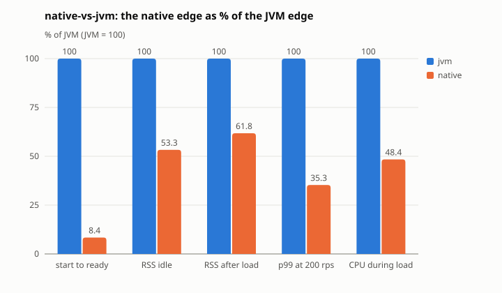
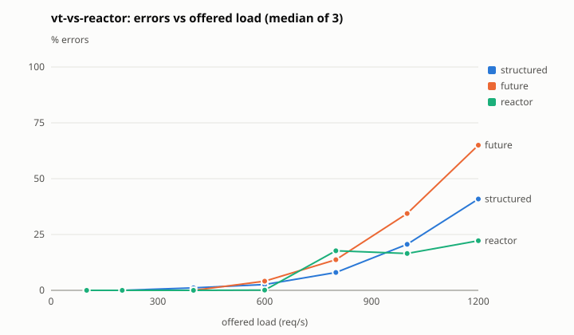

# Portfolio card: keyedge

<!-- The portfolio site (prj_porfolio_mk) parses exactly these six `##` sections. Keep the headings; images must
be files in this repository. Tested by scripts/tests/test_docs_policy.py (make docs-policy). -->

## Title
keyedge: API keys and a native sidecar that protects without becoming the outage

## Pitch
How do you issue and rotate API keys safely, and check every request next to the service without making the
checker the next outage? A Java 25 lab, run entirely on two local AWS emulators:
- a control plane that stores only peppered hashes, with idempotent creation and overlap rotation;
- a GraalVM-native sidecar: cached verdicts with single flight, a lock-free limiter proven with jcstress,
  a breaker with a fail-static policy, adaptive concurrency;
- the same infrastructure as CDK in Java and in Python, proven byte-identical, run as a real ECS task;
- measured claims with predictions written first, including three that the data refuted.

## Media
- 
- 

## Highlights
- **jcstress found the race:** a naive token bucket handed the last token to two threads in 10.6 % of ~200 M
  samples; the CAS limiters never did ([notebook](lab-notebook.md#naive-bucket-race-phase-003)).
- **Native sidecar:** ready in 322 ms instead of 3.9 s, about half the memory, a third of the p99 at 200 req/s
  ([notebook](lab-notebook.md#native-vs-jvm-phase-010)).
- **Control plane down, traffic up:** fail-static served every warm key and refused every cold or revoked one;
  revocation latency is bounded and stated ([notebook](lab-notebook.md#control-plane-outage-phase-008)).
- **Virtual threads or Reactor?** Built both on one use case; under load the quotes bulkheads, not the CPU, set the
  ceiling, and the Reactor twin held 600 req/s where the virtual-thread adapters did not
  ([notebook](lab-notebook.md#vt-vs-reactor-phase-015)).
- **Two emulators, one contract:** the same tests and CDK templates on Floci and AWS Emulator, every difference a
  row in the [parity page](parity.md), including an ECS that reports RUNNING with no containers.

## Tech stack
Java 25 · Micronaut 5 · GraalVM native image · virtual threads · structured concurrency · Project Reactor · DynamoDB · Secrets Manager · SSM · KMS · AWS CDK (Java and Python) · cdk-nag · Floci · AWS Emulator · jcstress · JMH · jqwik · PIT · ArchUnit · OpenTelemetry · Prometheus · Grafana · k6 · SOPS + age · cosign · Docker Compose · GitHub Actions

## Links
- [Repository README](../README.md)
- [Lab notebook](lab-notebook.md)
- [Architecture](architecture.md) and [threat model](threat-model.md)
- [Emulator parity](parity.md)
- [Virtual threads vs Reactor](virtual-threads-vs-reactor.md)
