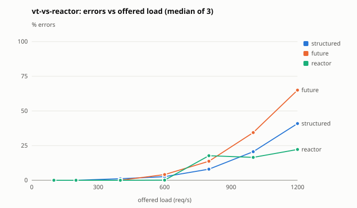

# Virtual threads or Reactor? The same use case, built both ways

The quotes service answers `GET /v1/quotes/{sku}` by calling three upstreams at once — pricing (needs an OAuth
token), stock and fx — and combining the answers. It is built **twice**: a blocking version on virtual threads
(`/v1/quotes`) and a Reactor twin (`/v1/quotes-reactive`). Both share the domain (`QuoteAssembler`), the HTTP
mapping, the breakers and bulkheads; a parity test holds them to the same status and body in every scenario.
This page explains the two models, what the lab chose and why, and links the measurements.

## 1. The two models, same flow

**Virtual threads** — each request runs on its own cheap thread; the code blocks, and the JVM parks the virtual
thread instead of an OS thread. The fan-out is structured concurrency
([`StructuredFanOut`](../libs/fanout-structured/src/main/java/dev/keyedge/fanout/structured/StructuredFanOut.java)):

```java
public QuoteOutcome handle(QuoteRequest q, RequestContext ctx) {
  var d = ctx.deadline();
  var r = ScopedValue.where(RequestContext.CURRENT, ctx).call(() ->
      fanOut.all(
          Call.required("pricing", () -> pricing.price(q.sku(), d)),
          Call.required("stock",   () -> stock.stock(q.sku(), d)),
          Call.optional("fx",      () -> fx.rate(base, q.currency(), d)),
          d));
  return QuoteAssembler.assemble(q.sku(), q.quantity(), q.currency(), r.first(), r.second(), r.third());
}
// inside the adapter: StructuredTaskScope.open(Joiner.allUntil(requiredFailed), cfg -> cfg.withTimeout(...))
```

**Reactor** — a request is a pipeline of operators on a few event-loop threads; nothing blocks
([`ReactorQuoteFlow`](../services/quotes/src/main/java/dev/keyedge/quotes/adapters/reactor/ReactorQuoteFlow.java)):

```java
Mono<Price> price = guarded(pricing(sku, ctx), protections.pricing(), ...).map(Upstream::price);
Mono<Stock> stock = guarded(get("stock", ...), protections.stock(), ...).map(Upstream::stock);
Mono<CallResult<FxRate>> fx = guarded(get("fx", ...), protections.fx(), ...)
    .map(Upstream::fx).map(CallResult.Ok::new)
    .onErrorResume(e -> Mono.just(new CallResult.Failed<>("fx", Optional.empty()))); // BEFORE zip
return Mono.zip(price.onErrorMap(e -> new Failure("pricing", e)),
                stock.onErrorMap(e -> new Failure("stock", e)), fx)
    .map(t -> QuoteAssembler.assemble(q.sku(), q.quantity(), q.currency(), ok(t.getT1()), ok(t.getT2()), t.getT3()))
    .onErrorResume(Failure.class, f -> Mono.just(unavailable(f)))
    .toFuture();
```

## 2. Side by side

| Aspect | Reactor | Virtual threads |
|---|---|---|
| Code shape | operator chains; logic inside `flatMap`s | sequential code, normal control flow |
| Errors | `onErrorResume`/`onErrorMap`, exceptions as signals | `try/catch`, sealed result values |
| Stack traces | fragmented (assembly vs run time) | complete; debugger and JFR understand them |
| Request context | Reactor `Context`; `ThreadLocal` unusable | `ScopedValue`, inherited by structured forks |
| Libraries | non-blocking end to end | blocking libraries are fine |
| Fan-out | `Mono.zip`, very expressive | `StructuredTaskScope` (preview in 25) or futures |
| Cancellation | built in (dispose propagates) | structured: siblings interrupted; I/O must honour interrupts |
| Backpressure | built in for streams | none: limits must be explicit (bulkheads, adaptive limits) |
| Learning curve | steep | "normal Java" |

## 3. What the lab chose, and why

Virtual threads by default, with this Reactor twin kept for comparison:

1. **The workload is request/response with a small fan-out**, where virtual threads give Reactor-class results
   with sequential code (measured below). Reactor's unique strength — streaming with backpressure — is not what
   these endpoints do.
2. **Readability and testability**: use cases and ports stay plain Java (an ArchUnit rule keeps `reactor..` inside
   `adapters.reactor` and the twin's controller).
3. **Java 25 removed the main caveat**: `synchronized` no longer pins the carrier thread (JEP 491); `ScopedValue`
   is final.
4. **Honesty through measurement**: the twin exists so the comparison is a result, not an opinion.
5. **Reactor stays where it is the right tool**: the edge sidecar streams proxied bodies with a `Publisher`-based
   client; only the admission decision before it runs on a virtual thread (measured hand-off cost +0.09 ms).

## 4. Gotchas, each with a test

- **`CompletableFuture` does not inherit `ScopedValue`s** — the futures adapter captures and re-binds the context
  explicitly (`ContextCarrier`); `FutureFanOutTest.withoutTheCarrierTheContextIsMissing` shows the failure.
- **`CompletableFuture.cancel(true)` does not interrupt a running `supplyAsync` task** — so the futures adapter
  keeps the `Future` from `executor.submit` (`completableFutureCancelDoesNotInterrupt`). The `cancel-on-failure`
  experiment shows the consequence: the naive version leaves every slow upstream call running to the end.
- **`Mono.zip` cancels everything on the first error** — including an *optional* call's failure, unless that
  failure is turned into a value before the zip. The parity test's `fx-down` scenario covers it.
- **Cheap threads are not cheap downstreams** — every upstream has a bulkhead and a breaker; the sidecar has an
  adaptive concurrency limit.
- **Preview APIs spread**: javac refuses to read a class compiled with `--enable-preview` unless the reader is too.
  The structured adapter lives in its own module and is found through `ServiceLoader`, so only that module is
  compiled with preview (the quotes JVM still runs with `--enable-preview`).
- **Signalling before publishing**: the first futures adapter signalled completion from inside the task, before
  the `FutureTask` held its result; under the stack's real timing `resultNow()` failed. Tasks now publish their
  result first (regression test `instantCallsAlwaysYieldTheirResults`).

## 5. Evidence

- [`results/labs/fanout-models.json`](../results/labs/fanout-models.json): at 10 req/s the three models' p50 are
  within 5.7 % of each other (23.0–24.3 ms; the slowest upstream answers in 20 ms); at 300 req/s all three keep up
  with no errors, p50 25–28 ms, p99 64–114 ms, and process CPU per request 9.6–10.9 ms. The run shared the host
  with the compose stack, so the 300 req/s tails are noise-dominated: no model wins at this size, which is the
  finding. CPU per request covers the whole process (fake upstreams included). Phase 015 measures properly.
- [`results/labs/cancel-on-failure.json`](../results/labs/cancel-on-failure.json): pricing fails at 50 ms, stock
  takes 2 s: structured (p50 72 ms) and futures-with-submit (p50 64 ms) return early **and** the stock server sees
  all 5 connections closed; the naive `CompletableFuture` version returns just as early (p50 58 ms) but all 5 stock
  calls run to completion.
- [`results/labs/retry-only-idempotent.json`](../results/labs/retry-only-idempotent.json),
  [`results/labs/token-stampede.json`](../results/labs/token-stampede.json): retries and the shared token.
- Load curves and CPU per request at scale (Phase 015,
  [`bench-result.json`](../results/bench/20261123-165813-vt-vs-reactor/bench-result.json),
  [notebook](lab-notebook.md#vt-vs-reactor-phase-015)): offered 100–1 200 req/s straight to quotes, 3 repetitions.
  The ceiling was quotes' own bulkheads, not the CPU: the structured adapter failed the error SLO from 400 req/s,
  the futures adapter from 600, the Reactor twin held 600 at ≤ 0.2 % errors. CPU per request was within ~15 % at
  400 req/s and above (Reactor lowest). Prediction (CPU-bound tie near 1 600 req/s): refuted.


